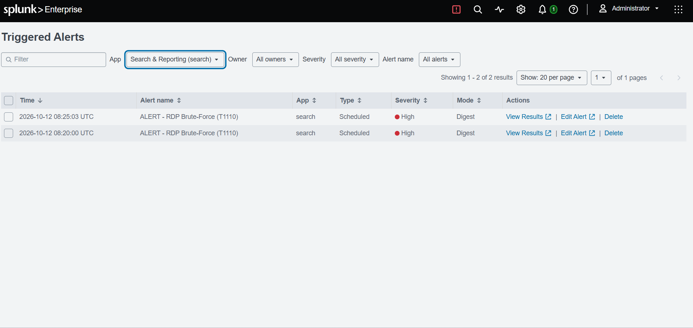
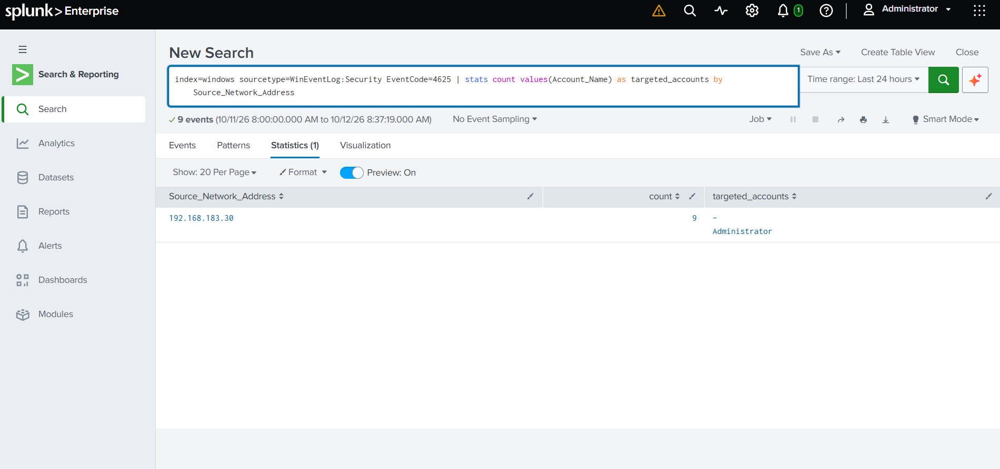
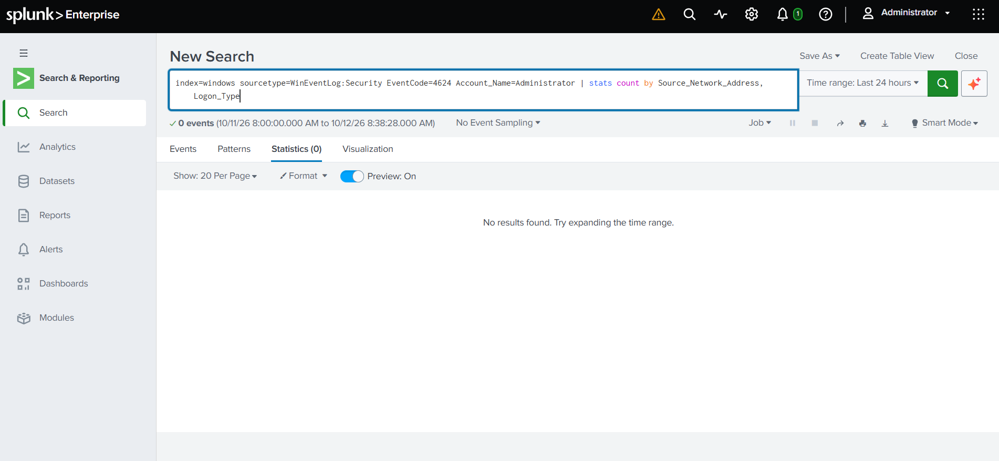
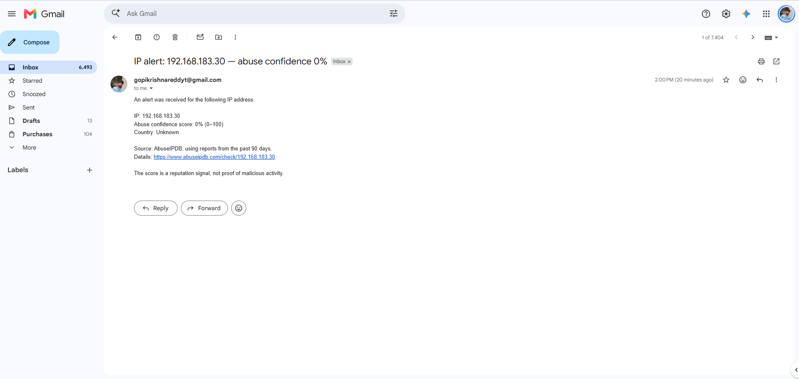

# Incident 01 — RDP Brute-Force Attempt on Windows Host

| Field | Value |
|-------|-------|
| **Ticket ID** | SOC-2026-001 |
| **Date/Time** | 2026-10-12, ~08:11–08:20 UTC |
| **Analyst** | L1 SOC Analyst |
| **Severity** | High |
| **Status** | Closed — True Positive (No Compromise) |
| **MITRE ATT&CK** | T1110 — Brute Force |

---

## 1. Alert

A scheduled Splunk alert — **"ALERT - RDP Brute-Force (T1110)"** — triggered at High severity, indicating repeated failed authentication against a monitored Windows host over RDP.



---

## 2. Investigation

### Step 1 — Identify the failed logons (Event ID 4625)

```spl
index=windows sourcetype=WinEventLog:Security EventCode=4625
| stats count values(Account_Name) as targeted_accounts by Source_Network_Address
```

**Result:** 9 failed logons from a single source against the `Administrator` account.

| Source_Network_Address | count | targeted_accounts |
|------------------------|-------|-------------------|
| 192.168.183.30 | 9 | Administrator |



### Step 2 — Check whether the attack succeeded (Event ID 4624)

```spl
index=windows sourcetype=WinEventLog:Security EventCode=4624 Account_Name=Administrator
| stats count by Source_Network_Address, Logon_Type
```

**Result:** 0 successful logons from the attacker IP (searched across All time).



---

## 3. Analysis

A single source IP (192.168.183.30) generated repeated failed logons against a single privileged account (`Administrator`) in a short time window — the signature of a brute-force attack. No corresponding Event ID 4624 (successful logon) was observed from the attacker IP, confirming that none of the password guesses succeeded.

- **Attacker IP:** 192.168.183.30
- **Target host:** Windows 10 (192.168.183.20)
- **Target account:** Administrator
- **Failed logons (4625):** 9
- **Successful logons (4624) from attacker:** 0

---

## 4. Automated Enrichment (SOAR)

The alert triggered a Tines workflow via webhook, which queried **AbuseIPDB** for the source IP's reputation and emailed a summary to the analyst inbox — automating the enrichment step of triage.

- **AbuseIPDB confidence score:** 0% (source is an internal/private lab IP with no public reputation data)



---

## 5. Verdict

**True Positive** — a genuine brute-force attack occurred.
**No compromise** — all authentication attempts failed; credentials were not breached.

---

## 6. Recommendations

1. Block / monitor source IP **192.168.183.30**.
2. Enforce an **account lockout policy** after a threshold of failed attempts.
3. Restrict RDP exposure — VPN-only access, enforce **Network Level Authentication (NLA)**, or disable RDP if unused.
4. Enable **"Audit Logon — Success"** auditing to positively confirm logon outcomes in future investigations.

---

## MITRE ATT&CK Mapping

| Tactic | Technique | ID |
|--------|-----------|-----|
| Credential Access | Brute Force | T1110 |
