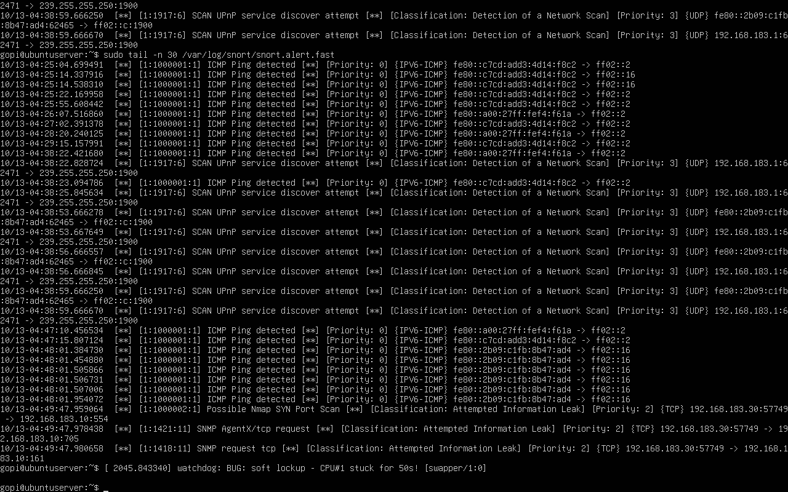
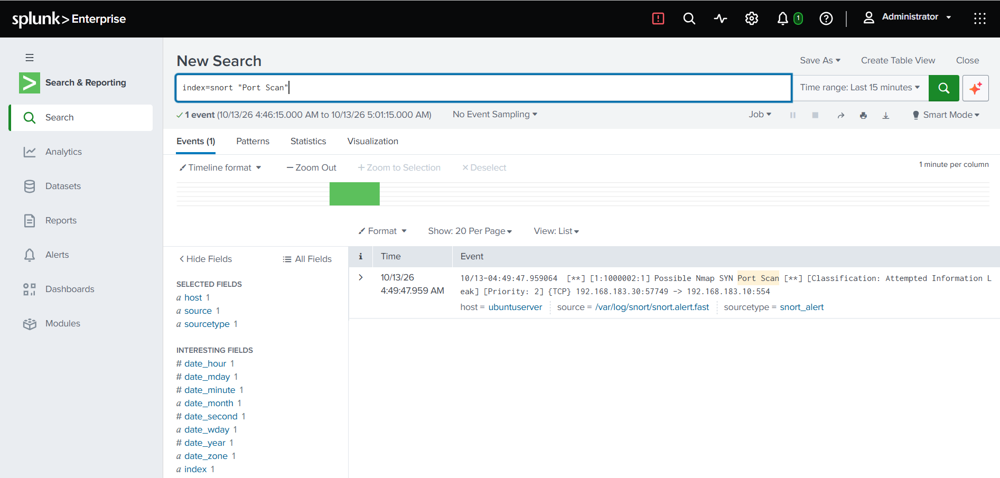

# Incident 02 — Nmap Port Scan Detected by IDS

| Field | Value |
|-------|-------|
| **Ticket ID** | SOC-2026-002 |
| **Date/Time** | 2026-10-13, ~04:49 UTC |
| **Analyst** | L1 SOC Analyst |
| **Severity** | Medium |
| **Status** | Closed — True Positive (Reconnaissance, No Exploitation) |
| **MITRE ATT&CK** | T1046 — Network Service Discovery |

---

## 1. Alert

The Snort IDS raised a custom rule alert — **"Possible Nmap SYN Port Scan"** (sid 1000002) — indicating an active TCP SYN scan against a monitored host. The alert was forwarded into Splunk (`snort` index) for correlation.



---

## 2. Investigation

### Step 1 — Review the IDS alert

```
10/13-04:49:47.959064  [1:1000002:1] Possible Nmap SYN Port Scan [**]
[Classification: Attempted Information Leak] [Priority: 2] {TCP}
192.168.183.30:57749 -> 192.168.183.10:554
```

- **Source (attacker):** 192.168.183.30
- **Destination (target):** 192.168.183.10
- **Scan type:** TCP SYN (half-open) scan
- A burst of SYN packets to many destination ports from one source = port scan signature.

### Step 2 — Confirm in the SIEM

```spl
index=snort "Port Scan"
```

The Snort alert is present in Splunk (`sourcetype = snort_alert`, `host = ubuntuserver`), confirming the detection pipeline (Snort → log file → Splunk) is working.



### Step 3 — Determine what the scan exposed

The attacker's own Nmap output shows which services were discovered on the target:

| Port | State | Service |
|------|-------|---------|
| 22/tcp | open | SSH |
| 8000/tcp | open | HTTP (Splunk Web) |
| 8089/tcp | open | Splunk management |


---

## 3. Analysis

A single source IP (192.168.183.30) performed a TCP SYN scan against the server (192.168.183.10), enumerating open ports and services. This is classic **reconnaissance** — the attacker is mapping the attack surface, typically the first stage before targeted exploitation or brute-force.

No exploitation or authentication attempts followed in this event; the activity was limited to service discovery. However, the exposed services (SSH, Splunk Web/management) are high-value follow-up targets.

- **Attacker IP:** 192.168.183.30
- **Target host:** 192.168.183.10 (SIEM server)
- **Technique:** TCP SYN port scan
- **Services exposed:** SSH (22), Splunk Web (8000), Splunk mgmt (8089)

---

## 4. Verdict

**True Positive** — a genuine network reconnaissance scan occurred.
**No exploitation** — activity limited to service discovery; no breach.

---

## 5. Recommendations

1. Block / monitor source IP **192.168.183.30** and watch for follow-up activity (brute-force, exploit attempts) against the discovered ports.
2. Restrict management services (SSH 22, Splunk 8089) to trusted hosts via firewall / network segmentation.
3. Rate-limit or drop scan traffic at the firewall where feasible.
4. Ensure the exposed services are patched and use strong authentication.

---

## MITRE ATT&CK Mapping

| Tactic | Technique | ID |
|--------|-----------|-----|
| Discovery | Network Service Discovery | T1046 |
