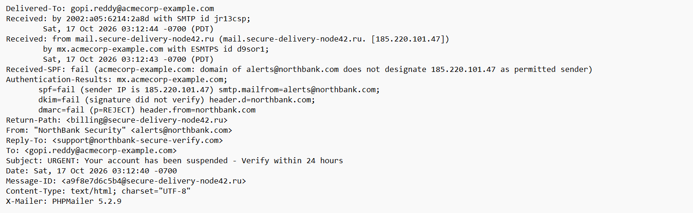
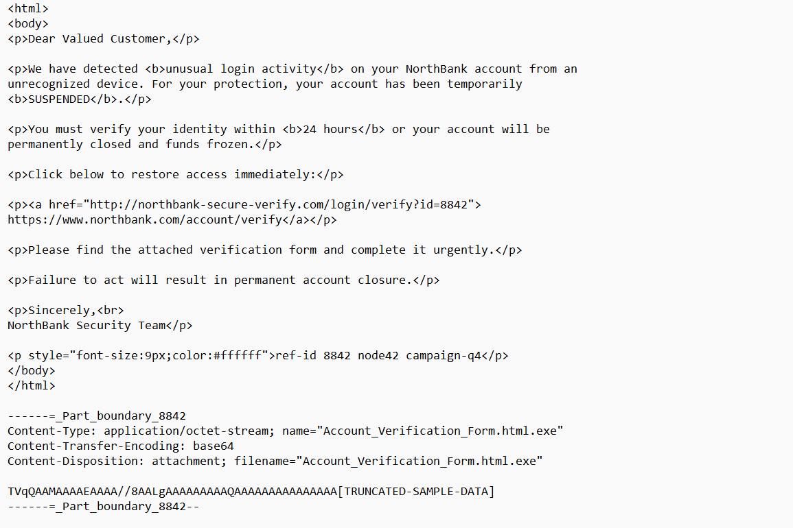

# Incident 03 — Phishing Email Analysis

| Field | Value |
|-------|-------|
| **Ticket ID** | SOC-2026-003 |
| **Date/Time** | 2026-10-18 |
| **Analyst** | L1 SOC Analyst |
| **Severity** | High |
| **Status** | Closed — True Positive (Malicious Phishing) |
| **MITRE ATT&CK** | T1566.001 — Phishing: Spearphishing Attachment / T1566.002 — Spearphishing Link |

---

## 1. Alert

A suspicious email was reported for analysis. The message claimed to be from "NorthBank Security" warning of account suspension and demanding identity verification within 24 hours. The email was analysed at the header, link, and attachment level to determine whether it is a genuine notification or a phishing attempt.



---

## 2. Investigation

### Step 1 — Authentication Checks (SPF / DKIM / DMARC)

```
Authentication-Results:
    spf=fail   (sender IP 185.220.101.47 not permitted for northbank.com)
    dkim=fail  (signature did not verify)
    dmarc=fail (p=REJECT)
```

All three authentication mechanisms **failed**. The sending server is not authorised for the claimed domain, the signature is invalid, and the domain's DMARC policy instructs receivers to reject. This is a strong indicator the email is **spoofed**.

### Step 2 — Sender Verification (From / Return-Path / Reply-To)

| Header | Value | Domain |
|--------|-------|--------|
| From | alerts@northbank.com | northbank.com (claimed) |
| Return-Path | billing@secure-delivery-node42.ru | secure-delivery-node42**.ru** (Russia) |
| Reply-To | support@northbank-secure-verify.com | lookalike domain |

Three different, mismatched domains. A genuine email uses a single consistent domain. The true origin (`Return-Path`) is a Russian `.ru` server, and replies are directed to an attacker-controlled lookalike domain.

### Step 3 — Source Server & IP

```
Received: from mail.secure-delivery-node42.ru [185.220.101.47]
```

The originating server is in Russia and the IP (185.220.101.47) falls within a known Tor / malicious range — not a legitimate bank mail server.

### Step 4 — Link Analysis

```html
<a href="http://northbank-secure-verify.com/login/verify?id=8842">
   https://www.northbank.com/account/verify</a>
```

- **Display text:** `https://www.northbank.com/account/verify` (looks legitimate)
- **Actual URL (href):** `http://northbank-secure-verify.com/login/verify` (attacker-controlled lookalike, plain HTTP)

The visible text and the real destination do not match — a classic credential-harvesting technique.



### Step 5 — Attachment Analysis

```
filename="Account_Verification_Form.html.exe"
```

The attachment uses a **double extension** (`.html.exe`). It appears to be an HTML document but is actually a Windows executable — likely malware. Dangerous file type delivered under a deceptive name.

---

## 3. Analysis

The email impersonates a bank, fails all authentication checks, originates from a malicious Russian server, contains a deceptive credential-harvesting link, and carries an executable disguised as a form. It uses urgency and fear ("suspended", "24 hours", "funds frozen") and a generic greeting to pressure the victim.

**Indicators of Compromise (IOCs):**
- Sender server: secure-delivery-node42.ru
- Source IP: 185.220.101.47
- Malicious link domain: northbank-secure-verify.com
- Attachment: Account_Verification_Form.html.exe

---

## 4. Verdict

**True Positive — Malicious Phishing Email.**
Credential-harvesting + malware delivery attempt. Not a genuine bank communication.

---

## 5. Recommendations

1. **Quarantine / delete** the email from all affected mailboxes.
2. **Block** the sender domain, Reply-To domain, link domain, and source IP at the mail gateway and firewall.
3. **Alert the targeted user** — do not click the link or open the attachment.
4. Add IOCs to threat-intel blocklists.
5. If any user interacted with the email, reset their credentials and scan their endpoint.
6. Reinforce user awareness on urgency-based phishing and attachment handling.

---

## Phishing Red Flags Summary

| # | Red Flag |
|---|----------|
| 1 | SPF, DKIM, DMARC all failed (spoofed) |
| 2 | From / Return-Path / Reply-To — three mismatched domains |
| 3 | Malicious Russian source server + Tor-range IP |
| 4 | Deceptive link — display text vs actual URL mismatch |
| 5 | Malicious attachment — double extension (.html.exe) |
| 6 | Urgency / fear language + generic greeting |

---

## MITRE ATT&CK Mapping

| Tactic | Technique | ID |
|--------|-----------|-----|
| Initial Access | Phishing: Spearphishing Link | T1566.002 |
| Initial Access | Phishing: Spearphishing Attachment | T1566.001 |
