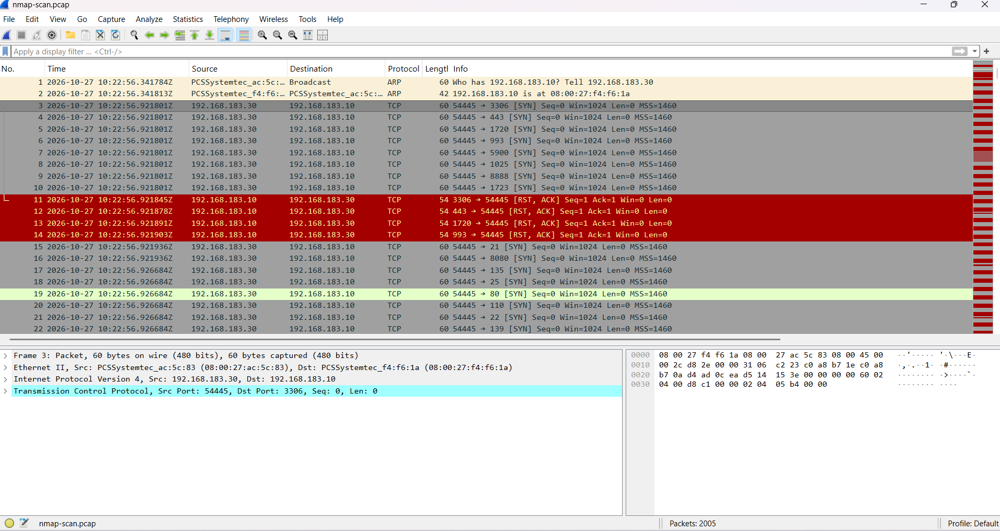
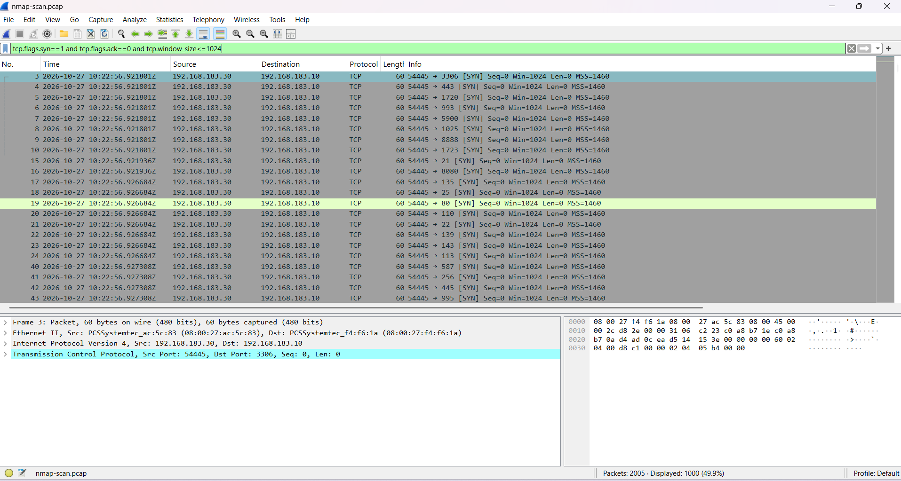
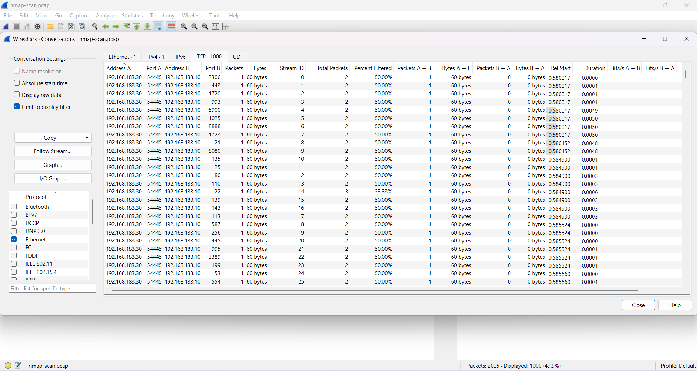

# Incident 04 — Nmap SYN Scan Detected via Packet Capture

| Field | Value |
|-------|-------|
| **Ticket ID** | SOC-2026-004 |
| **Date/Time** | 2026-10-27, ~10:22 UTC |
| **Analyst** | L1 SOC Analyst |
| **Severity** | Medium |
| **Status** | Closed — True Positive (Reconnaissance, No Exploitation) |
| **MITRE ATT&CK** | T1046 — Network Service Discovery |

---

## 1. Alert

A packet capture (`nmap-scan.pcap`) taken from a monitored host was provided for analysis. The traffic was reviewed in Wireshark to determine whether it represented normal activity or a network reconnaissance attempt against the host.

> The capture was recorded on the target host with `tcpdump` and analysed offline from the saved PCAP — the standard SOC workflow (capture on the sensor, investigate the file).



---

## 2. Investigation

### Step 1 — Review the raw capture

```
tcpdump -i enp0s8 host 192.168.183.30 -w nmap-scan.pcap
```

The capture (2,005 packets) opens with ARP, followed by a large burst of TCP SYN packets:

```
Who has 192.168.183.10? Tell 192.168.183.30        (ARP — attacker locating target)
192.168.183.30 → 192.168.183.10  54445 → 3306 [SYN] Win=1024
192.168.183.30 → 192.168.183.10  54445 → 443  [SYN] Win=1024
192.168.183.30 → 192.168.183.10  54445 → 22   [SYN] Win=1024
...
192.168.183.10 → 192.168.183.30  3306 → 54445 [RST, ACK]   (closed port reply)
```

- A single source (192.168.183.30) sends SYN packets from a fixed source port (54445) to many different destination ports.
- Each SYN has `Win=1024` and `Len=0` — the signature of a half-open **SYN scan** (the attacker never completes the handshake).
- Closed ports reply with `RST, ACK`; the single open port replies with `SYN, ACK`.
- All activity occurs within ~0.58 seconds — automated tooling, not manual.

### Step 2 — Isolate the scan with a display filter

```
tcp.flags.syn==1 and tcp.flags.ack==0 and tcp.window_size<=1024
```

**Result:** 1,000 packets displayed — the attacker probed **1,000 TCP ports** on the target.



### Step 3 — Confirm with Statistics → Conversations

```
Statistics → Conversations
```

- **IPv4 tab:** a single conversation — one attacker (192.168.183.30) to one target (192.168.183.10).
- **TCP tab:** 1,000 separate conversations — one per scanned port, each a single 60-byte SYN with no data returned.

A single IP pair generating 1,000 one-packet TCP conversations is a textbook port-scan fan-out.



---

## 3. Analysis

A single source IP (192.168.183.30) performed a TCP SYN scan against the target (192.168.183.10), probing 1,000 ports in under a second. This is classic **reconnaissance** — the attacker is enumerating the attack surface before any targeted follow-up.

Of the 1,000 ports probed, one responded as **open** (22/TCP — SSH); the remainder returned `RST, ACK` (closed). No exploitation or authentication attempts followed in this capture; activity was limited to service discovery.

- **Attacker IP:** 192.168.183.30
- **Target host:** 192.168.183.10
- **Technique:** TCP SYN (half-open) scan — `nmap -sS`
- **Ports probed:** 1,000
- **Open service exposed:** SSH (22/TCP)
- **Scan duration:** ~0.58 s (automated)

---

## 4. Verdict

**True Positive** — a genuine network reconnaissance scan occurred.
**No exploitation** — activity limited to port/service discovery; no breach.

---

## 5. Recommendations

1. Block / monitor source IP **192.168.183.30** and watch for follow-up activity (brute-force, exploit attempts) against the discovered SSH service.
2. Restrict SSH (22/TCP) to trusted hosts via firewall rules / network segmentation.
3. Deploy an IDS rule (e.g. Snort) to alert on SYN-scan patterns — many destination ports from one source in a short window.
4. Rate-limit or drop scan traffic at the firewall where feasible.
5. Ensure exposed services are patched and enforce strong authentication (key-based SSH).

---

## MITRE ATT&CK Mapping

| Tactic | Technique | ID |
|--------|-----------|-----|
| Discovery | Network Service Discovery | T1046 |

---

## Artefacts

| File | Description |
|------|-------------|
| `nmap-scan.pcap` | Raw packet capture of the scan (2,005 packets) |
| `screenshots/incident-4/` | Supporting evidence (scan packets, SYN filter, conversations) |
