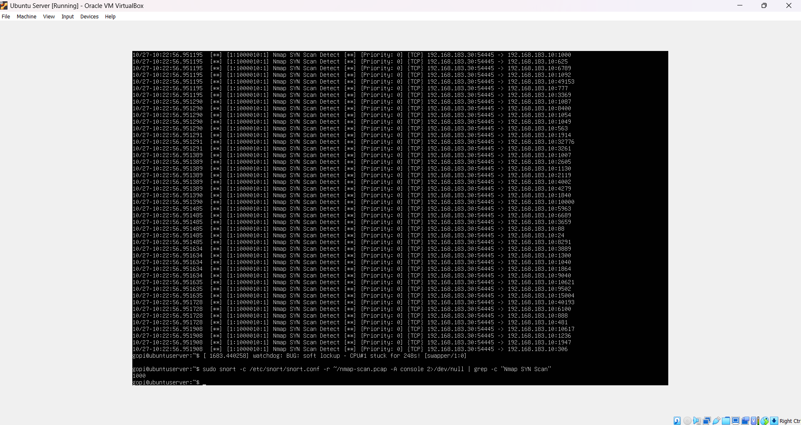
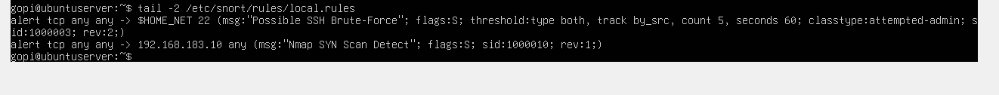

# Incident 05 — Nmap Scan Detected with Custom Snort IDS Rule

| Field | Value |
|-------|-------|
| **Ticket ID** | SOC-2026-005 |
| **Date/Time** | 2026-10-27, ~10:22 UTC (capture) / analysed 2026-11-05 |
| **Analyst** | L1 SOC Analyst |
| **Severity** | Medium |
| **Status** | Closed — True Positive (Reconnaissance, No Exploitation) |
| **MITRE ATT&CK** | T1046 — Network Service Discovery |

---

## 1. Alert

A captured packet file (`nmap-scan.pcap`) from a monitored host was run through **Snort** (open-source NIDS) using a custom detection rule to confirm whether the traffic contained a network scan. This is detection-engineering work: writing an IDS signature and validating it against recorded traffic — Snort's **PCAP investigation mode**.



---

## 2. Investigation

### Step 1 — Write a custom detection rule

A local Snort rule was added to `/etc/snort/rules/local.rules` to detect SYN-only packets (the signature of a half-open SYN scan):

```
alert tcp any any -> 192.168.183.10 any (msg:"Nmap SYN Scan Detect"; flags:S; sid:1000010; rev:1;)
```

**Rule breakdown:**
- `alert tcp` — raise an alert on matching TCP traffic
- `any any -> 192.168.183.10 any` — from any source to the target host, any port
- `flags:S` — match packets with **only the SYN flag set** (scan probes; a completed handshake sets SYN+ACK)
- `sid:1000010` — unique local rule ID (local rules use 1000000+)

A second custom rule from earlier lab work is also present, detecting SSH brute-force attempts:

```
alert tcp any any -> $HOME_NET 22 (msg:"Possible SSH Brute-Force"; flags:S; threshold:type both, track by_src, count 5, seconds 60; classtype:attempted-admin; sid:1000003; rev:2;)
```



### Step 2 — Run Snort against the captured traffic

```bash
sudo snort -c /etc/snort/snort.conf -q -r nmap-scan.pcap -A console
```

- `-c /etc/snort/snort.conf` — Snort config (includes the local rules)
- `-r nmap-scan.pcap` — read the saved capture (offline / PCAP investigation mode)
- `-A console` — print alerts to the console

### Step 3 — Review the alerts

Snort fired rule `1:1000010` on every scan probe:

```
[1:1000010:1] Nmap SYN Scan Detect [**] [Priority: 0] {TCP} 192.168.183.30:54445 -> 192.168.183.10:<port>
```

Counting the alerts:

```bash
sudo snort -c /etc/snort/snort.conf -r nmap-scan.pcap -A console 2>/dev/null | grep -c "Nmap SYN Scan"
1000
```

**1,000 alerts** — one per scanned port. This matches the Wireshark analysis in [Incident 04](incident-04-nmap-syn-scan.md) (1,000 SYN packets to 1,000 ports), independently confirming the finding through a second tool.

---

## 3. Analysis

The custom Snort rule correctly detected the TCP SYN scan recorded in the capture. A single source (192.168.183.30) sent SYN probes to 1,000 ports on the target (192.168.183.10) from a fixed source port (54445) — classic **reconnaissance**.

- **Attacker IP:** 192.168.183.30
- **Target host:** 192.168.183.10
- **Rule triggered:** `sid:1000010` — "Nmap SYN Scan Detect"
- **Alerts generated:** 1,000 (one per probed port)
- **Technique:** TCP SYN (half-open) scan

This demonstrates the full detection pipeline: a signature written by the analyst, validated against real captured traffic, producing actionable alerts.

---

## 4. Verdict

**True Positive** — the IDS rule detected a genuine network reconnaissance scan.
**No exploitation** — activity limited to port discovery.

---

## 5. Recommendations

1. Deploy the SYN-scan rule in live IDS mode to alert on scans in real time.
2. Tune the rule with a `detection_filter` / `threshold` so one scan raises a single consolidated alert instead of one per port, reducing alert fatigue.
3. Block / monitor source IP **192.168.183.30** and watch for follow-up against the exposed SSH service.
4. Restrict SSH (22/TCP) to trusted hosts and enforce key-based authentication.

---

## MITRE ATT&CK Mapping

| Tactic | Technique | ID |
|--------|-----------|-----|
| Discovery | Network Service Discovery | T1046 |

---

## Skills Demonstrated

- Snort IDS rule writing (custom signatures, `flags`, `threshold`, `sid`)
- PCAP investigation with Snort (offline analysis of captured traffic)
- Cross-tool validation (Snort alerts confirming Wireshark findings)
- Detection engineering and alert tuning
