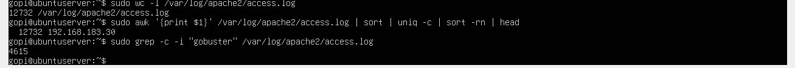
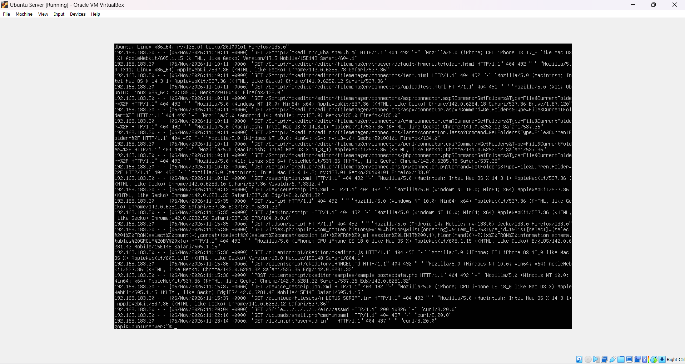
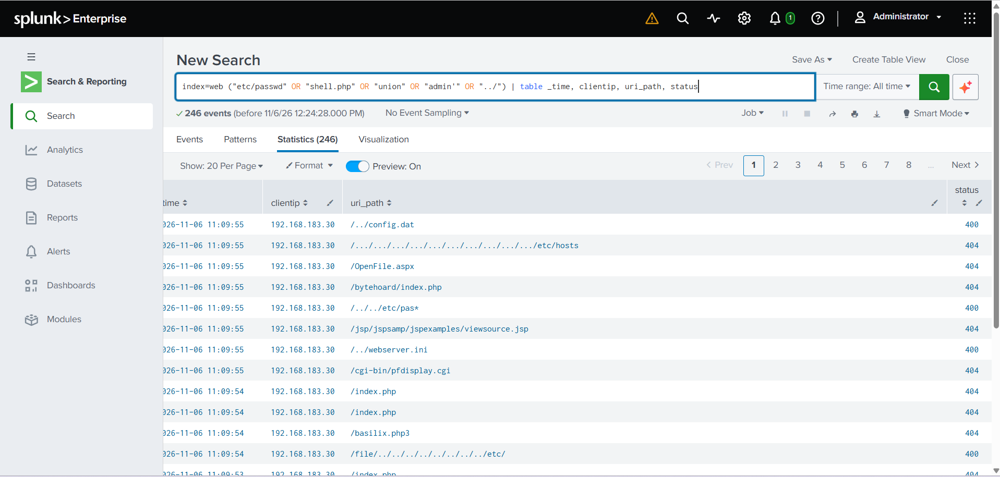
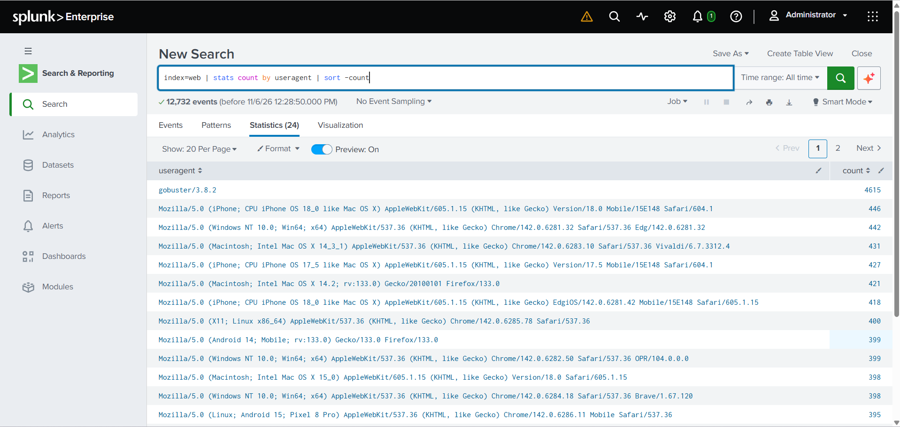

# Incident 06 — Web Server Attack Detection (Log Analysis + SIEM)

| Field | Value |
|-------|-------|
| **Ticket ID** | SOC-2026-006 |
| **Date/Time** | 2026-11-06, ~10:50–11:23 UTC |
| **Analyst** | L1 SOC Analyst |
| **Severity** | High |
| **Status** | Closed — True Positive (Web Reconnaissance & Attack Attempts, No Compromise) |
| **MITRE ATT&CK** | T1595 — Active Scanning / T1190 — Exploit Public-Facing Application / T1083 — File & Directory Discovery |

---

## 1. Alert

An Apache web server (`192.168.183.10`) generated an unusually high volume of traffic from a single source. The web server access logs (`/var/log/apache2/access.log`) were analysed — first directly with command-line tools, then ingested into **Splunk** for SIEM-based detection — to determine the nature of the activity.



---

## 2. Investigation

### Step 1 — Log volume and top talker (command line)

```bash
sudo wc -l /var/log/apache2/access.log
# 12732

sudo awk '{print $1}' /var/log/apache2/access.log | sort | uniq -c | sort -rn | head
# 12732 192.168.183.30
```

**All 12,732 requests originated from a single IP (192.168.183.30).** Legitimate traffic is spread across many clients with low per-IP counts; a single source generating 12,732 requests is a clear automated-attack signature.

### Step 2 — Scanner tool fingerprint

```bash
sudo grep -c -i "gobuster" /var/log/apache2/access.log
# 4615
```

The `gobuster/3.8.2` User-Agent appears 4,615 times — a directory brute-force tool. The remaining traffic was generated by **Nikto**, which randomises its User-Agent to evade detection.

### Step 3 — Malicious request patterns

```bash
sudo grep -iE "etc/passwd|shell.php|admin'|union|script|\.\./" /var/log/apache2/access.log
```

The log contains classic web-attack payloads from 192.168.183.30:

```
GET /?file=../../../../etc/passwd          → Path Traversal
GET /uploads/shell.php?cmd=whoami          → Web Shell access attempt
GET /login.php?user=admin'--               → SQL Injection
GET /index.php?...UNION...SELECT...FROM information_schema.tables  → SQL Injection
GET /?q=<script>alert(1)</script>          → Cross-Site Scripting (XSS)
```



### Step 4 — SIEM detection (Splunk)

The access log was ingested into Splunk (`sourcetype=access_combined`, `index=web`), which auto-extracted fields (`clientip`, `uri_path`, `status`, `useragent`).

**Confirm single attacker:**
```spl
index=web | stats count by clientip | sort -count
```
Result: one client — `192.168.183.30`.

**Isolate malicious requests:**
```spl
index=web ("etc/passwd" OR "shell.php" OR "union" OR "admin'" OR "../")
| table _time, clientip, uri_path, status
```
Result: **246 malicious requests** — path traversal (`/../../etc/`, `/etc/hosts`), web-shell and SQLi probes — all from the attacker IP.



**Scanner / User-Agent analysis:**
```spl
index=web | stats count by useragent | sort -count
```
Result: `gobuster/3.8.2` (4,615) plus 20+ randomised `Mozilla/5.0` User-Agents from a single IP — automated tooling with User-Agent spoofing.



---

## 3. Analysis

A single source (192.168.183.30) directed a multi-stage web attack at the server (192.168.183.10):

1. **Reconnaissance** — `gobuster` directory brute-force (4,615 requests) enumerating hidden paths.
2. **Vulnerability scanning** — `nikto` (≈8,000 requests) probing for known vulnerabilities, with randomised User-Agents.
3. **Targeted exploitation attempts** — manual SQL injection, path traversal, web-shell access, and XSS payloads.

Almost all requests returned `404`/`400` (the server had no vulnerable application), so **no exploitation succeeded**. The activity was reconnaissance and attack attempts, not a breach.

- **Attacker IP:** 192.168.183.30
- **Target host:** 192.168.183.10 (Apache 2.4.58)
- **Total requests:** 12,732 (all from one IP)
- **Tools:** gobuster, nikto, curl
- **Attack types:** directory brute-force, SQLi, path traversal, web shell, XSS

---

## 4. Verdict

**True Positive** — a genuine multi-vector web attack (scanning + exploitation attempts) occurred.
**No compromise** — all payloads returned error codes; no vulnerable application was present.

---

## 5. Recommendations

1. **Block / monitor** source IP **192.168.183.30** at the firewall.
2. Deploy a **Web Application Firewall** (e.g. ModSecurity) to block SQLi/traversal/XSS patterns at the HTTP layer.
3. Enforce **rate limiting** to throttle high-volume scanning from a single source.
4. Create a **Splunk alert** for web attacks — e.g. a single `clientip` exceeding a request threshold, or requests matching attack patterns (`etc/passwd`, `union`, `../`, `shell.php`).
5. Ensure the web application validates input and the server is patched and hardened (remove `server-status`, add security headers).

---

## MITRE ATT&CK Mapping

| Tactic | Technique | ID |
|--------|-----------|-----|
| Reconnaissance | Active Scanning | T1595 |
| Initial Access | Exploit Public-Facing Application | T1190 |
| Discovery | File & Directory Discovery | T1083 |

---

## Skills Demonstrated

- Web server (Apache) log analysis — identifying attacks in `access.log`
- Command-line log triage (`wc`, `awk`, `grep`, `sort`, `uniq`)
- SIEM ingestion & detection — Splunk data input, `access_combined` sourcetype, custom index
- SPL detection queries (`stats count by`, attack-pattern filtering, User-Agent analysis)
- Recognising web attack signatures: SQLi, path traversal, web shell, XSS, scanner tools
- End-to-end detection pipeline: web logs → SIEM → actionable detection
