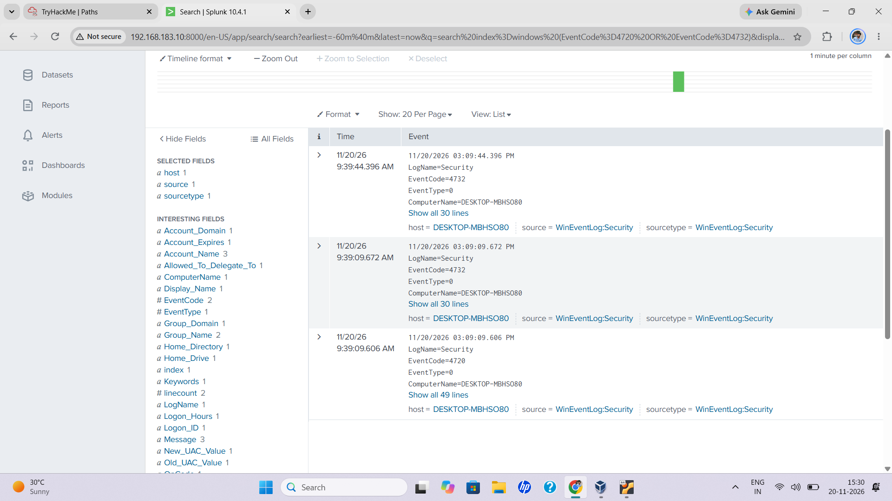
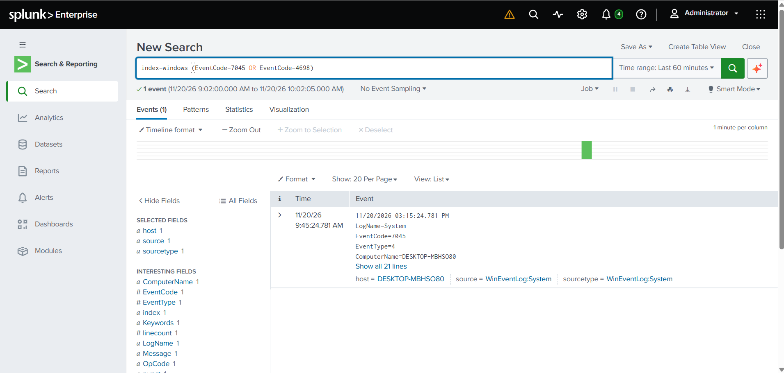
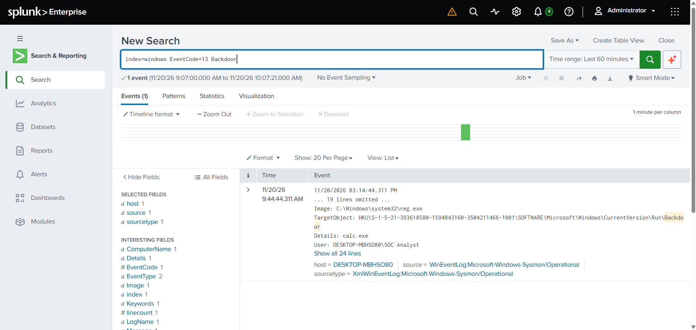
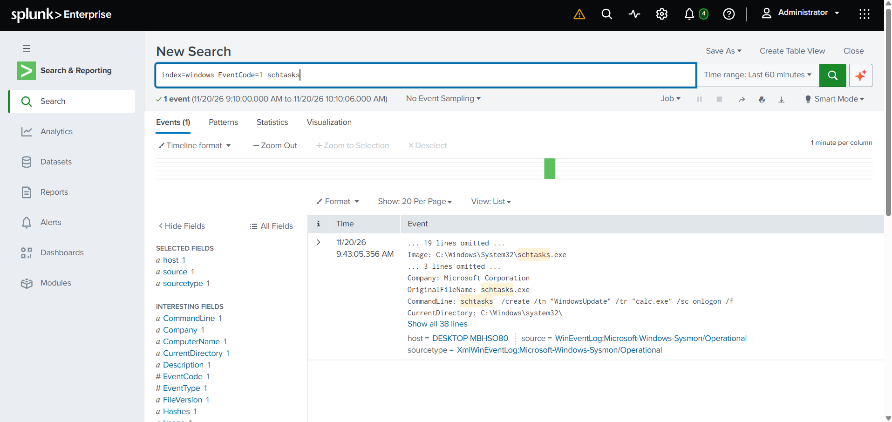

# Incident 07 — Windows Post-Breach Activity (Account Creation & Persistence)

| Field | Value |
|-------|-------|
| **Ticket ID** | SOC-2026-007 |
| **Date/Time** | 2026-11-20, ~15:09–15:15 UTC+5:30 |
| **Analyst** | L1 SOC Analyst |
| **Severity** | High |
| **Status** | Closed — True Positive (Post-Exploitation Activity, Contained) |
| **MITRE ATT&CK** | T1136.001 Create Account / T1098 Account Manipulation / T1543.003 Service / T1053.005 Scheduled Task / T1547.001 Registry Run Keys |

---

## 1. Alert

Suspicious administrative activity was observed on a monitored Windows 10 endpoint (`DESKTOP-MBHSO80`). Windows Security logs and **Sysmon** telemetry — forwarded into Splunk (`index=windows`) — were reviewed to determine whether a threat actor had established an account and persistence on the host after an initial breach.

> The activity simulates what an attacker does **after** gaining access: create a backdoor account and plant multiple persistence mechanisms. Each action was detected through its Windows / Sysmon event signature in the SIEM.



---

## 2. Investigation

### Step 1 — Backdoor administrator account (Event ID 4720 + 4732)

```spl
index=windows (EventCode=4720 OR EventCode=4732)
```

**Result:** 3 events on `DESKTOP-MBHSO80` (Security log):

- **4720** — a new local account, `hacker`, was **created**.
- **4732** — the `hacker` account was **added to the Administrators group**.

A newly created account immediately elevated to local admin is a classic attacker-persistence signature (MITRE T1136.001 / T1098).

### Step 2 — Malicious service (Event ID 7045)

```spl
index=windows (EventCode=7045 OR EventCode=4698)
```

**Result:** **7045** — a new service, **`EvilSvc`**, was installed (System log). Services that start automatically are used to survive reboots (MITRE T1543.003).



### Step 3 — Registry Run key (Sysmon Event ID 13)

```spl
index=windows EventCode=13 Backdoor
```

**Result:** Sysmon **13** (registry value set):

```
Image:        C:\Windows\system32\reg.exe
TargetObject: ...\CurrentVersion\Run\Backdoor
Details:      calc.exe
User:         DESKTOP-MBHSO80\SOC Analyst
```

A `Run` key value makes the payload launch at every user logon (MITRE T1547.001).



### Step 4 — Scheduled task (Sysmon Event ID 1)

```spl
index=windows EventCode=1 schtasks
```

**Result:** Sysmon **1** (process creation):

```
Image:       C:\Windows\System32\schtasks.exe
CommandLine: schtasks /create /tn "WindowsUpdate" /tr "calc.exe" /sc onlogon /f
```

A task masquerading as "WindowsUpdate" that runs on every logon (MITRE T1053.005). The dedicated task-creation event (4698) was not logged because that audit sub-category is off by default — Sysmon process creation caught it instead, showing the value of layered logging.



---

## 3. Analysis

A threat actor operating on `DESKTOP-MBHSO80` performed a full post-breach persistence routine:

| # | Action | Detection |
|---|--------|-----------|
| 1 | Created local account `hacker` | Security **4720** |
| 2 | Added `hacker` to Administrators | Security **4732** |
| 3 | Installed service `EvilSvc` | System **7045** |
| 4 | Added `Run\Backdoor` registry key | Sysmon **13** |
| 5 | Created `WindowsUpdate` scheduled task | Sysmon **1** (schtasks) |

Four independent persistence mechanisms plus a privileged backdoor account — the host must be treated as fully compromised. All five actions were captured by the Windows → Sysmon → Splunk pipeline, demonstrating end-to-end endpoint detection.

- **Host:** DESKTOP-MBHSO80
- **Backdoor account:** `hacker` (local Administrator)
- **Persistence:** service `EvilSvc`, scheduled task `WindowsUpdate`, registry `Run\Backdoor`

---

## 4. Verdict

**True Positive** — genuine post-exploitation account creation and persistence activity.
**Contained** — detected in the SIEM; backdoor account and persistence artefacts removed during response (see recommendations).

---

## 5. Recommendations

1. **Remove** the backdoor account and persistence artefacts:
   - `net user hacker /delete`
   - `sc delete EvilSvc`
   - `schtasks /delete /tn "WindowsUpdate" /f`
   - `reg delete "HKCU\Software\Microsoft\Windows\CurrentVersion\Run" /v Backdoor /f`
2. **Isolate** the host and investigate how initial access was obtained.
3. Create **Splunk alerts**: any `4720`/`4732`, `7045`, Sysmon `13` on `Run` keys, and Sysmon `1` for `schtasks`/`sc` — these should page an analyst.
4. Enable the **Audit Other Object Access Events** policy so scheduled-task creation (4698) is logged natively.
5. Restrict local admin rights and monitor privileged group changes.

---

## MITRE ATT&CK Mapping

| Tactic | Technique | ID |
|--------|-----------|-----|
| Persistence | Create Account: Local Account | T1136.001 |
| Persistence | Account Manipulation | T1098 |
| Persistence | Create or Modify System Process: Windows Service | T1543.003 |
| Persistence | Scheduled Task/Job | T1053.005 |
| Persistence | Boot or Logon Autostart: Registry Run Keys | T1547.001 |

---

## Skills Demonstrated

- Windows Security event-log analysis (4720, 4732, 7045)
- Sysmon telemetry analysis (Event ID 1 process creation, Event ID 13 registry)
- Detecting post-exploitation persistence in a SIEM (Splunk SPL)
- Mapping attacker actions to MITRE ATT&CK techniques
- Layered logging — catching a technique via Sysmon when the native audit event is disabled
