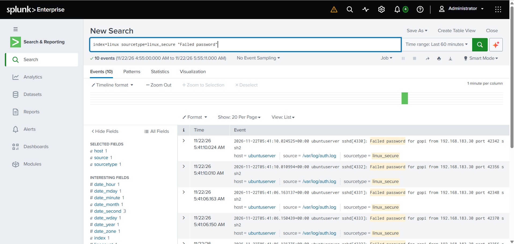
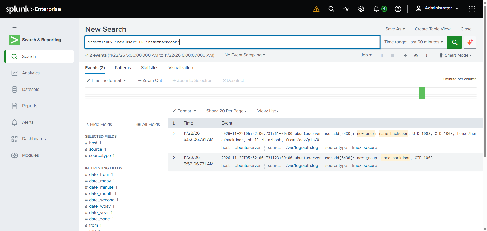
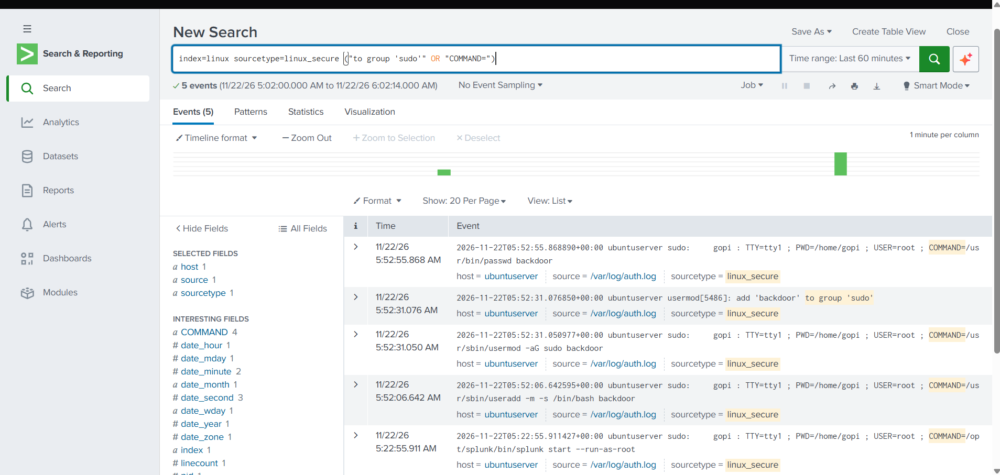

# Incident 08 — Linux SSH Brute-Force & Backdoor Account

| Field | Value |
|-------|-------|
| **Ticket ID** | SOC-2026-008 |
| **Date/Time** | 2026-11-22, ~05:41–05:52 UTC |
| **Analyst** | L1 SOC Analyst |
| **Severity** | High |
| **Status** | Closed — True Positive (Successful Intrusion Simulated, Contained) |
| **MITRE ATT&CK** | T1110 Brute Force / T1136.001 Create Account / T1098 Account Manipulation / T1548.003 Sudo |

---

## 1. Alert

A monitored Linux server (`ubuntuserver`, 192.168.183.10) showed a burst of failed SSH logins followed by privileged account activity. Linux authentication logs (`/var/log/auth.log`, `sourcetype=linux_secure`) forwarded into Splunk (`index=linux`) were reviewed to reconstruct the attack.



---

## 2. Investigation

### Step 1 — SSH brute-force (T1110)

```spl
index=linux sourcetype=linux_secure "Failed password"
```

**Result:** 10 failed SSH logins against user `gopi`, all from a single source:

```
ubuntuserver sshd[...]: Failed password for gopi from 192.168.183.30 port ... ssh2
```

Ten failures from one IP in seconds is an automated brute-force (hydra/`-P` wordlist). The attacker IP is **192.168.183.30**.

### Step 2 — Backdoor account creation (T1136.001)

```spl
index=linux "new user" OR "name=backdoor"
```

**Result:**

```
useradd[5430]: new group: name=backdoor, GID=1003
useradd[5430]: new user:  name=backdoor, UID=1003, shell=/bin/bash, from=/dev/pts/0
```

A new interactive account `backdoor` (with a `/bin/bash` shell) was created — a persistence mechanism (MITRE T1136.001).



### Step 3 — Privilege escalation & sudo trail (T1098 / T1548.003)

```spl
index=linux sourcetype=linux_secure ("to group 'sudo'" OR "COMMAND=")
```

**Result:** 5 events showing the full privileged command trail:

```
usermod[5486]: add 'backdoor' to group 'sudo'
sudo:  gopi : ... USER=root ; COMMAND=/usr/sbin/useradd -m -s /bin/bash backdoor
sudo:  gopi : ... USER=root ; COMMAND=/usr/sbin/usermod -aG sudo backdoor
sudo:  gopi : ... USER=root ; COMMAND=/usr/bin/passwd backdoor
```

The `backdoor` account was **added to the `sudo` group** — it is now a full administrator. The `sudo` log lines record every privileged command the attacker executed (MITRE T1098 / T1548.003).



---

## 3. Analysis

A single source (192.168.183.30) carried out a complete Linux intrusion chain:

| # | Action | Detection |
|---|--------|-----------|
| 1 | SSH brute-force against `gopi` | `Failed password` × 10 |
| 2 | Discovery (`whoami`, `id`, `sudo -l`) | command execution |
| 3 | Created account `backdoor` | `useradd` — new user |
| 4 | Added `backdoor` to `sudo` group | `usermod` — group change |
| 5 | Set the account password | `sudo … passwd backdoor` |

The attacker established a privileged backdoor account that survives reboots and provides persistent admin access. The host must be treated as compromised. Every stage was visible in `auth.log` through the Splunk pipeline, demonstrating end-to-end Linux detection.

- **Attacker IP:** 192.168.183.30
- **Target host:** ubuntuserver (192.168.183.10)
- **Targeted user:** `gopi` (brute-force)
- **Backdoor account:** `backdoor` (sudo group, `/bin/bash`)

---

## 4. Verdict

**True Positive** — genuine SSH brute-force followed by backdoor account creation and privilege escalation.
**Contained** — detected in the SIEM; backdoor account removed during response.

---

## 5. Recommendations

1. **Remove** the backdoor account: `sudo deluser --remove-home backdoor`.
2. **Block** source IP 192.168.183.30 at the firewall; rotate `gopi`'s credentials.
3. Harden SSH: disable password auth (key-based only), disable root login, change the default port, and deploy **fail2ban** to auto-ban brute-force sources.
4. Create **Splunk alerts**: N+ `Failed password` from one source in a short window; any `useradd` / `usermod … sudo`; unexpected `sudo` command trails.
5. Audit `/etc/passwd`, `/etc/group`, and `~/.ssh/authorized_keys` for other unauthorized changes.

---

## MITRE ATT&CK Mapping

| Tactic | Technique | ID |
|--------|-----------|-----|
| Credential Access | Brute Force | T1110 |
| Persistence | Create Account: Local Account | T1136.001 |
| Persistence | Account Manipulation | T1098 |
| Privilege Escalation | Abuse Elevation Control Mechanism: Sudo | T1548.003 |

---

## Skills Demonstrated

- Linux authentication-log analysis (`/var/log/auth.log`, `sourcetype=linux_secure`)
- Detecting SSH brute-force, account creation and privilege escalation in a SIEM (Splunk SPL)
- Reconstructing a full Linux intrusion timeline from logs
- Mapping Linux attacker actions to MITRE ATT&CK
