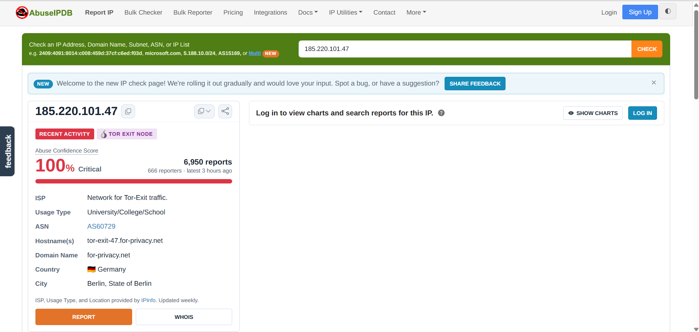
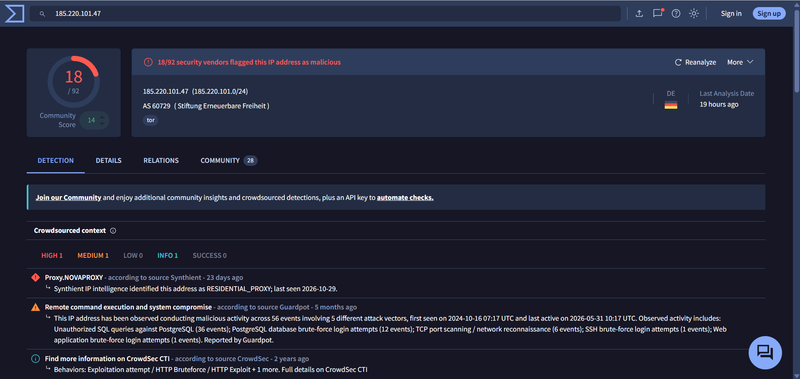
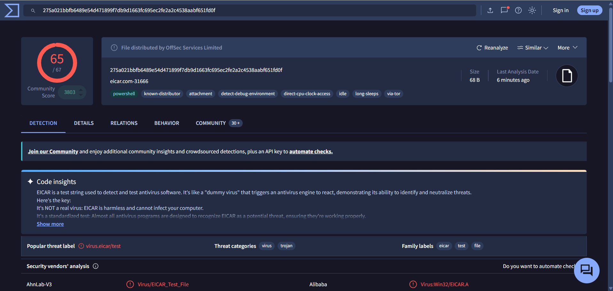

# Incident 09 — IOC Threat-Intelligence Enrichment

| Field | Value |
|-------|-------|
| **Ticket ID** | SOC-2026-009 |
| **Date/Time** | 2026-11-23 |
| **Analyst** | L1 SOC Analyst |
| **Severity** | Informational (enrichment of prior alerts) |
| **Status** | Closed — IOCs Confirmed Malicious |
| **Related** | [Incident 03 — Phishing Email](incident-03-phishing-email.md) |

---

## 1. Alert

Indicators of Compromise (IOCs) observed in earlier investigations were enriched against open-source threat-intelligence sources to confirm their reputation and support a block/escalation decision. This is the enrichment step of day-to-day L1 triage — taking an IP, domain or hash from an alert and checking what the wider security community knows about it.

**IOCs enriched:**
- IP address `185.220.101.47` — the source server of the phishing email in Incident 03
- File hash (SHA256) `275a021bbfb6489e54d471899f7db9d1663fc695ec2fe2a2c4538aabf651fd0f` — a sample malicious-file hash

---

## 2. Investigation

### IOC 1 — IP `185.220.101.47` (AbuseIPDB)

```
Indicator: 185.220.101.47
Source:    AbuseIPDB
```

- **Abuse Confidence Score: 100% (Critical)**
- **6,950 reports** from 666 reporters, most recent ~3 hours before lookup
- **Tor Exit Node** (ISP: "Network for Tor-Exit traffic", hostname `tor-exit-47.for-privacy.net`)
- Country: Germany (Berlin), ASN AS60729



### IOC 1 — IP `185.220.101.47` (VirusTotal, cross-check)

```
Source: VirusTotal
```

- **18 / 92 security vendors flagged the IP as malicious**; community score **14** (negative); tagged **tor**
- Crowdsourced context — **56 malicious events across 5 attack vectors**: unauthorized SQL queries against PostgreSQL (36), database brute-force (12), TCP port scanning / reconnaissance (6), SSH brute-force, and web-application brute-force
- CrowdSec behaviours: "Exploitation attempt / HTTP Bruteforce / HTTP Exploit"



Two independent sources agree: the IP is an actively abused Tor exit node with a long history of attacks — **confirmed malicious**.

### IOC 2 — File hash (VirusTotal)

```
SHA256: 275a021bbfb6489e54d471899f7db9d1663fc695ec2fe2a2c4538aabf651fd0f
Source: VirusTotal
```

- **65 / 67 security vendors detected the file as malicious**
- Popular threat label: `virus.eicar/test`; threat categories **virus, trojan**
- Vendor names: `Virus/EICAR_Test_File` (AhnLab), `Virus:Win32/EICAR.A` (Alibaba)



> This sample is the EICAR anti-malware **test file** — a safe, industry-standard string that every AV engine flags, used here to demonstrate the hash-lookup workflow. For a real sample the same process returns the actual malware family name (e.g. WannaCry, Emotet), guiding containment.

---

## 3. Analysis

| IOC | Type | Sources | Finding | Verdict |
|-----|------|---------|---------|---------|
| 185.220.101.47 | IP | AbuseIPDB, VirusTotal | 100% abuse score, Tor exit node, 6,950 reports, 56 attack events | **Malicious** |
| 275a02…51fd0f | SHA256 | VirusTotal | 65/67 vendors, virus/trojan | **Malicious** |

The phishing source IP from Incident 03 is independently confirmed as a high-confidence malicious Tor exit node, validating the original "suspicious source" finding. The file hash is flagged by virtually all engines. Enriching against multiple sources (AbuseIPDB **and** VirusTotal) avoids relying on a single feed and raises confidence in the verdict.

---

## 4. Verdict

**Both IOCs confirmed malicious** by multiple independent threat-intelligence sources. Suitable for blocking and for addition to internal threat-intel lookups.

---

## 5. Recommendations

1. **Block** 185.220.101.47 at the firewall / mail gateway and add it to the Splunk known-bad IP lookup.
2. Consider blocking inbound **Tor exit-node** ranges where business need allows.
3. **Quarantine/block** any file matching the malicious hash; alert if the hash is seen on any endpoint.
4. Automate this enrichment via **SOAR** (AbuseIPDB / VirusTotal API) so IP and hash reputation is attached to alerts automatically — as prototyped in [Incident 01](incident-01-rdp-bruteforce.md).
5. Record confirmed IOCs in a central threat-intel list and periodically re-check reputation.

---

## Tools Used

| Tool | Purpose |
|------|---------|
| **AbuseIPDB** | IP abuse reputation & reports |
| **VirusTotal** | IP / file multi-engine reputation, crowdsourced attack context |

---

## Skills Demonstrated

- IOC enrichment with open-source threat intelligence (the core L1 triage step)
- IP reputation analysis (AbuseIPDB abuse score, Tor exit-node identification)
- Multi-source cross-validation (AbuseIPDB + VirusTotal) to avoid single-feed bias
- File-hash reputation lookup (VirusTotal detection ratio, threat labels)
- Turning threat intel into actionable block / escalation decisions
